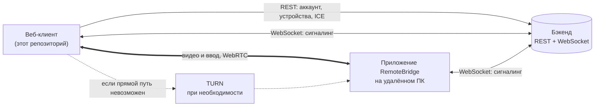
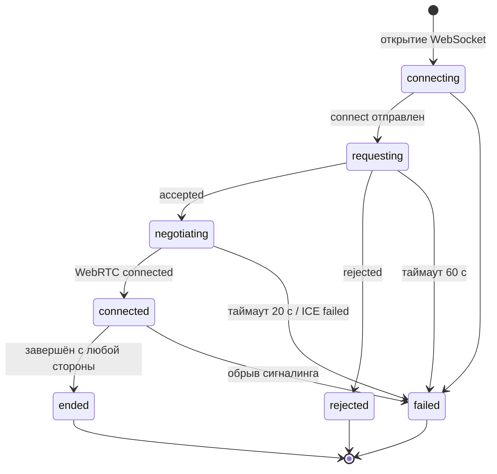
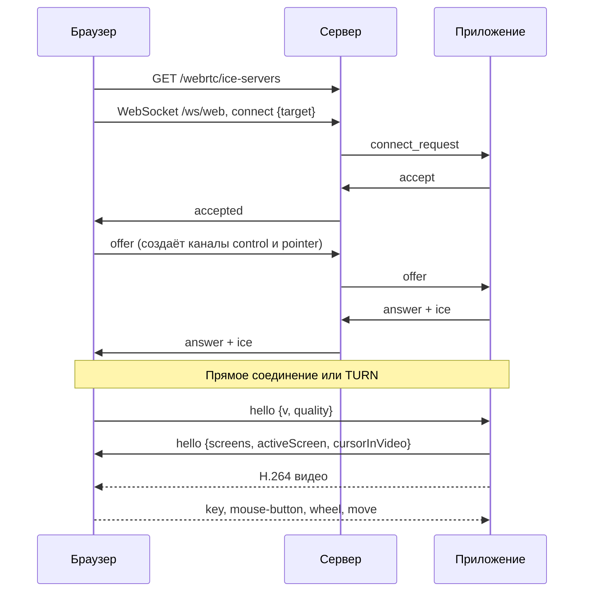

<div align="center">

# RemoteBridge Web

**Веб-клиент сервиса удалённого доступа RemoteBridge. Управляйте компьютером из браузера: ввели ID, получили подтверждение, работаете.**


[Сервис](https://remote.yarovich.ru) · [Приложение для Windows](https://github.com/RanVix/RemoteBridgePublic) · [Возможности](#возможности) · [Запуск](#быстрый-старт) · [Развёртывание](#развёртывание-в-docker)

</div>

<!--
  Добавьте скриншоты в docs/screenshots и раскомментируйте:

  <p align="center">
    
  </p>
-->

---

## О проекте

**RemoteBridge Web** — клиентская часть сервиса [RemoteBridge](https://remote.yarovich.ru). Через неё пользователь управляет аккаунтом и устройствами, а главное — подключается к удалённому компьютеру прямо из браузера, без установки программ на своей стороне.

Сам компьютер, к которому подключаются, запускает [приложение RemoteBridge для Windows](https://github.com/RanVix/RemoteBridgePublic): оно получает 12-значный ID, принимает запросы и транслирует экран. Веб-клиент выступает в роли зрителя и «пульта»: показывает видео, отправляет клавиатуру и мышь.

Видео и ввод передаются напрямую между браузером и приложением по **WebRTC**. Если прямое соединение невозможно (разные сети, строгий NAT, файрвол), автоматически используется TURN-ретранслятор.

## Возможности

**Удалённый сеанс**

- Подключение к устройству по ID и ожидание подтверждения от владельца (до 60 секунд)
- Видео H.264 с минимальной буферизацией на стороне приёмника: отзывчивость важнее гладкости
- Полный ввод: клавиатура (по физическим клавишам), мышь, колесо, боковые кнопки
- Корректные координаты при любом соотношении сторон: чёрные поля вокруг картинки учитываются, клики по ним игнорируются
- Несколько мониторов на удалённом ПК с переключением из панели
- Режимы качества «Скорость», «Баланс», «Качество» с переключением на лету
- Отправка **Ctrl+Alt+Del** и полноэкранный режим. В Chrome в полноэкранном режиме включается Keyboard Lock: `Esc`, `Alt+Tab`, `Ctrl+W` и часть системных сочетаний уходят на удалённый ПК, а не в браузер
- Панель состояния соединения: задержка, FPS, поток, разрешение, кодек, потери пакетов, путь (напрямую или через ретранслятор) и общая оценка качества
- Форма курсора синхронизируется с удалённой системой
- Безопасное освобождение ввода: при потере фокуса, сворачивании вкладки и завершении сеанса все нажатые клавиши и кнопки отпускаются

**Аккаунт и устройства**

- Регистрация, вход, выход, смена пароля
- Автоматическое обновление сессии без повторного входа
- «Мои устройства» и «Сохранённые устройства» со статусом «в сети» и временем последней активности (обновляются каждые 30 секунд)
- Переименование устройств
- История подключений с длительностью, статусом и быстрыми действиями «Ещё раз» и «В контакты»
- Выбор часового пояса для отображения времени

**Интерфейс**

- Адаптивная вёрстка: боковое меню на десктопе, нижняя панель на мобильных
- Состояния загрузки и ошибок везде: скелетоны, баннеры, кнопка «Повторить»
- Уважение к настройке `prefers-reduced-motion`

## Как это работает



Сервер нужен только для входа, списков устройств и обмена служебными сообщениями. Видео и управление идут напрямую.

### Жизненный цикл сеанса



### Последовательность подключения



## Стек

| Слой           | Технология                                                                |
| -------------- | ------------------------------------------------------------------------- |
| Фреймворк      | Next.js 16 (App Router), React 19                                         |
| Язык           | TypeScript (strict)                                                       |
| Стили          | Tailwind CSS v4, токены дизайн-системы в `globals.css`                    |
| Данные         | TanStack Query 5, axios                                                   |
| Иконки         | lucide-react                                                              |
| Шрифты         | Inter и Manrope (латиница и кириллица, `next/font`)                       |
| Реальное время | нативные WebSocket и WebRTC API браузера                                  |
| Качество кода  | ESLint 9 (`eslint-config-next`), Prettier + `prettier-plugin-tailwindcss` |
| Поставка       | Docker (multi-stage, `output: 'standalone'`)                              |

## Быстрый старт

### Требования

- Node.js **20.9+** (в Docker используется 22)
- npm
- Доступный бэкенд RemoteBridge (REST и WebSocket)

### Установка и запуск

```bash
git clone <адрес-репозитория>
cd <папка-проекта>
npm ci
```

Создайте файл `.env.local` в корне:

```env
NEXT_PUBLIC_API_URL=https://remote.yarovich.ru/api/v1
NEXT_PUBLIC_WS_URL=wss://remote.yarovich.ru/api/v1
```

Запустите dev-сервер:

```bash
npm run dev
```

Откройте [http://localhost:3000](http://localhost:3000). После изменения `.env.local` dev-сервер нужно перезапустить.

### Скрипты

| Команда         | Назначение                     |
| --------------- | ------------------------------ |
| `npm run dev`   | dev-сервер                     |
| `npm run build` | production-сборка (standalone) |
| `npm run start` | запуск собранного приложения   |
| `npm run lint`  | проверка ESLint                |

## Конфигурация

Все переменные имеют префикс `NEXT_PUBLIC_`, то есть **вшиваются в клиентский код на этапе сборки**. Для их смены в production пересоберите приложение.

| Переменная                 | Назначение                                                                                                                                  |
| -------------------------- | ------------------------------------------------------------------------------------------------------------------------------------------- |
| `NEXT_PUBLIC_API_URL`      | базовый адрес REST API, например `https://remote.yarovich.ru/api/v1`                                                                        |
| `NEXT_PUBLIC_WS_URL`       | базовый адрес WebSocket без `/ws/web`, например `wss://remote.yarovich.ru/api/v1`. Итоговый адрес сигналинга: `<NEXT_PUBLIC_WS_URL>/ws/web` |
| `NEXT_PUBLIC_FORCE_RELAY`  | `true` — браузер использует **только** TURN-ретранслятор. Режим отладки, в production не включать                                           |
| `NEXT_PUBLIC_DOWNLOAD_URL` | передаётся при сборке Docker-образа; в текущей версии кнопка скачивания ведёт на страницу релизов приложения на GitHub                      |

> Проверка TURN: соберите с `NEXT_PUBLIC_FORCE_RELAY=true`. Если видео идёт, а в панели состояния соединения указано «Через ретранслятор», TURN настроен верно.

## Маршруты

| Маршрут               | Назначение                                                                  | Доступ         |
| --------------------- | --------------------------------------------------------------------------- | -------------- |
| `/`                   | лендинг: описание сервиса и скачивание приложения                           | все            |
| `/login`, `/register` | вход и регистрация                                                          | все            |
| `/forgot-password`    | восстановление пароля (интерфейс готов, отправка письма пока не подключена) | все            |
| `/dashboard`          | подключение по ID, мои и сохранённые устройства                             | авторизованные |
| `/dashboard/history`  | история подключений                                                         | авторизованные |
| `/dashboard/settings` | часовой пояс                                                                | авторизованные |
| `/profile`            | данные аккаунта, смена пароля, выход                                        | авторизованные |
| `/session/[id]`       | удалённый сеанс с устройством `id`                                          | авторизованные |

Если сессия истекла и не удалось её обновить, клиент автоматически перенаправляет на `/login`.

## REST API

Клиент использует единый экземпляр axios (`withCredentials: true`, таймаут 15 с). Токены хранятся в `httpOnly`-куках и недоступны JavaScript.

| Метод | Путь                    | Назначение                                                      |
| ----- | ----------------------- | --------------------------------------------------------------- |
| POST  | `/auth/register`        | регистрация (`username`, `email`, `password`)                   |
| POST  | `/auth/login`           | вход, токены в `Set-Cookie`                                     |
| POST  | `/auth/refresh-token`   | обновление токенов                                              |
| POST  | `/auth/logout`          | выход                                                           |
| POST  | `/auth/change-password` | смена пароля (`oldPassword`, `newPassword`)                     |
| GET   | `/user/`                | профиль: `id`, `username`, `email`                              |
| GET   | `/user/devices`         | личные устройства                                               |
| PUT   | `/user/devices/{id}`    | `{name, is_online}`: переименование устройства                  |
| GET   | `/user/saved-devices`   | сохранённые чужие устройства                                    |
| PUT   | `/user/saved-devices`   | `{number}`: сохранить устройство; 404, 409 (уже сохранено), 429 |
| GET   | `/user/history`         | история подключений                                             |
| GET   | `/webrtc/ice-servers`   | временные STUN/TURN на сеанс                                    |

Поля устройства: `id`, `number`, `name`, `os_type`, `model`, `is_online`, `last_online`, `created_at`. Ответы преобразуются из snake_case в удобные модели на границе `lib/api`.

### Обновление токена

На ответ 401 клиент один раз вызывает `/auth/refresh-token` и повторяет исходный запрос. Параллельные запросы, получившие 401, ставятся в очередь и ждут один общий refresh. Эндпоинты входа и обновления refresh не запускают; для тихих проверок (например, «авторизован ли пользователь» на лендинге) есть флаг `skipAuthHandling`. Если refresh отклонён, генерируется событие `auth:session-expired`, и пользователь попадает на экран входа.

### Ошибки

`normalizeApiError` приводит ответы бэкенда к единому виду: общее сообщение и ошибки по полям (формат Spring), с понятными текстами для 404, 409 и 429 и отдельным сообщением при недоступности сервера.

## Сигналинг

WebSocket: `<NEXT_PUBLIC_WS_URL>/ws/web`. Авторизация идёт через куки браузера.

| Клиент → сервер                          | Сервер → клиент                             |
| ---------------------------------------- | ------------------------------------------- |
| `connect {target}`                       | `accepted`, `rejected`, `peer_disconnected` |
| `disconnect`                             | `error {message}`                           |
| `offer {sdp}`, `answer {sdp}`            | `offer`, `answer`                           |
| `ice {candidate, sdpMid, sdpMLineIndex}` | `ice`                                       |
| `input`, `data`                          | `input`, `data`                             |

Ошибки сервера (устройство не в сети, занято, неверный ID, уже подключён из другой вкладки и т. д.) переводятся в понятные пользователю сообщения. Таймауты: 60 секунд на ответ владельца, 20 секунд на WebRTC-рукопожатие.

## Протокол управления (версия 1)

JSON поверх WebRTC data channels: `control` (надёжный, упорядоченный) и `pointer` (неупорядоченный, без повторов; при заполненном буфере новые движения мыши отбрасываются). Поле `t` задаёт тип сообщения.

| Направление         | Сообщение                                         | Назначение                        |
| ------------------- | ------------------------------------------------- | --------------------------------- |
| клиент → приложение | `hello {v, quality}`                              | рукопожатие после открытия канала |
|                     | `key {down, code, key}`                           | клавиша (`KeyboardEvent.code`)    |
|                     | `mouse-button {down, button, x, y}`               | кнопка мыши                       |
|                     | `move {seq, x, y}`                                | движение (канал `pointer`)        |
|                     | `wheel {dx, dy, x, y}`                            | колесо (в долях 1/120 щелчка)     |
|                     | `release-all`                                     | отпустить всё нажатое             |
|                     | `special {action}`                                | `ctrl-alt-del`                    |
|                     | `quality {preset}`                                | `speed`, `balanced`, `quality`    |
|                     | `screen {index}`                                  | выбор монитора                    |
| приложение → клиент | `hello {v, screens, activeScreen, cursorInVideo}` | возможности                       |
|                     | `screen-changed {index}`                          | экран переключён                  |
|                     | `cursor {shape}`                                  | форма курсора                     |

Координаты нормализуются в диапазон `0…65535` относительно видимой области картинки. При несовпадении версии протокола сеанс завершается с просьбой обновить приложение.

## Архитектура

Реализация сеанса отделена от React: вся логика WebRTC живёт в `lib/realtime` обычными классами, а хук `useRemoteSession` связывает её с интерфейсом.

```
RemoteSessionView
 ├─ useRemoteSession ──► RemoteSession          состояние, таймауты, оркестрация
 │                        ├─ SignalingClient     WebSocket + типизированный протокол
 │                        ├─ ViewerPeer          RTCPeerConnection, каналы, кодеки
 │                        ├─ StatsMonitor        getStats() → метрики и оценка
 │                        └─ resolveIceServers   STUN/TURN от бэкенда
 ├─ RemoteScreen ──► InputController             события браузера → протокол
 └─ SessionToolbar                                панель управления сеансом
```

Основные решения:

- **Единый автомат состояний.** `RemoteSession` ведёт статусы `connecting → requesting → negotiating → connected` и конечные `rejected`, `ended`, `failed`; сообщения сигналинга обрабатываются строго последовательно через очередь.
- **Роли согласования.** Offer отправляет веб-клиент сразу после `accepted` (он же создаёт data channels). Роль задаётся константой `NEGOTIATION_ROLE`, при необходимости клиент работает и как answerer.
- **Кандидаты до offer.** ICE-кандидаты, пришедшие раньше remote description, буферизуются.
- **Приоритет кодеков.** H.264 → VP9 → AV1 → VP8; приложение выбирает первый поддерживаемый (сейчас H.264).
- **Минимальная задержка.** `jitterBufferTarget` (или `playoutDelayHint`) выставлен в 0; на нестабильной сети значение можно поднять в `lib/realtime/config.ts`.
- **Троттлинг ввода.** Движения мыши и колесо накапливаются и отправляются не чаще одного раза за кадр (`requestAnimationFrame`).
- **Надёжная очистка.** Сброс ввода при `blur`, `visibilitychange`, завершении сеанса и размонтировании.
- **ICE-серверы.** Берутся с бэкенда на каждый сеанс; разбор терпим к разным форматам ответа, TURN-адреса без логина и пароля отбрасываются с предупреждением. Публичный STUN используется как запасной вариант.
- **Состояние «вне React».** Часовой пояс хранится в `localStorage` и подписан через `useSyncExternalStore`, без лишних перерисовок и проблем гидратации.

## Структура проекта

```
src/
├── app/
│   ├── layout.tsx, providers.tsx, globals.css
│   ├── page.tsx                      # лендинг
│   ├── (auth)/                       # login, register, forgot-password
│   ├── dashboard/                    # главная, history, settings
│   ├── profile/
│   └── session/[id]/                 # удалённый сеанс
├── components/
│   ├── marketing/                    # Header, Hero, Features, Download, Footer
│   ├── layout/                       # AppShell, Sidebar, MobileTabBar, Logo
│   ├── dashboard/                    # ConnectPanel, DeviceList, DeviceRow, DeviceNameForm
│   ├── history/                      # HistoryList, HistoryRow
│   ├── profile/                      # профиль, смена пароля, выход
│   ├── settings/                     # TimeZoneSettings
│   ├── session/                      # RemoteSessionView, RemoteScreen, SessionToolbar
│   ├── auth/                         # SessionExpiredHandler
│   └── ui/                           # Button, Input, Select, Avatar, StatCard, StatusDot
├── hooks/                            # useCurrentUser, useDevices, useHistory, useRemoteSession, ...
├── lib/
│   ├── api/                          # axios-клиент, эндпоинты, ошибки, запросы
│   ├── realtime/                     # RemoteSession, ViewerPeer, SignalingClient, InputController, ...
│   ├── validation/                   # проверка форм
│   ├── datetime.ts, timezone.ts      # даты и часовые пояса
│   └── utils.ts
└── types/                            # типы API, сигналинга и протокола управления
```

## Дизайн-система

Токены заданы в `@theme` файла `globals.css` и повторяют дизайн десктопного приложения.

- **Акцент:** мятно-зелёный (`mint-500 #1FAE7C`), используется точечно.
- **Графит:** `ink-900 #10221C` для тёмных блоков и экрана сеанса, не чистый чёрный.
- **Красный** — только для ошибок и отказов.
- **Фон и линии:** `paper`, `paper-dim`, `line`.
- **Типографика:** Manrope для заголовков и крупных чисел, Inter для интерфейса.
- **Карточки:** скругление 16 px, тонкая рамка, без теней.

## Развёртывание в Docker

В репозитории есть multi-stage `Dockerfile` (сборка зависимостей, билд, минимальный runner) и `docker-compose.yml`. Образ запускается от непривилегированного пользователя, использует standalone-вывод Next.js и содержит healthcheck.

1. Задайте переменные окружения или создайте файл `.env` рядом с `docker-compose.yml`:

   ```env
   NEXT_PUBLIC_API_URL=https://remote.yarovich.ru/api/v1
   NEXT_PUBLIC_WS_URL=wss://remote.yarovich.ru/api/v1
   NEXT_PUBLIC_FORCE_RELAY=false
   ```

2. Соберите и запустите:

   ```bash
   docker compose up -d --build
   ```

Контейнер слушает `127.0.0.1:3000` — снаружи он недоступен, поэтому перед ним нужен обратный прокси (nginx, Caddy, Traefik) с HTTPS.

### Чек-лист production

- Сайт открыт по **HTTPS**: куки с флагом `Secure` и WebRTC требуют защищённого контекста
- Бэкенд разрешает CORS с передачей учётных данных для домена фронтенда
- Бэкенд и фронтенд на согласованных доменах, чтобы куки сессии отправлялись в запросах и WebSocket
- WebSocket-прокси пропускает заголовки `Upgrade` и `Connection` и не обрывает соединение по таймауту простоя слишком рано
- `GET /webrtc/ice-servers` возвращает рабочий TURN (проверка: `NEXT_PUBLIC_FORCE_RELAY=true` в тестовой сборке)
- `NEXT_PUBLIC_FORCE_RELAY` в боевой сборке выключен

## Совместимость с браузерами

Нужны современные браузеры с WebRTC (RTCPeerConnection, data channels) и Pointer Events. Рекомендуется Chrome или Edge: для них доступны Keyboard Lock в полноэкранном режиме, аппаратное декодирование H.264 и расширенные возможности настройки приёмника. В Firefox и Safari сеанс работает, но перехват системных сочетаний клавиш ограничен.

## Решение проблем

| Симптом                                                 | Что проверить                                                                                              |
| ------------------------------------------------------- | ---------------------------------------------------------------------------------------------------------- |
| «Не удалось подключиться к серверу»                     | Корректны ли `NEXT_PUBLIC_WS_URL` и доступность `/ws/web`; для HTTPS-сайта нужен `wss://`                  |
| «Устройство не в сети»                                  | На компьютере должно быть запущено приложение RemoteBridge, а в его окне виден статус «В сети»             |
| «Владелец не ответил на запрос»                         | Владелец не нажал «Разрешить» в течение 60 секунд                                                          |
| Соединение не устанавливается между разными сетями      | Бэкенд не отдаёт TURN или он недоступен; проверьте `/webrtc/ice-servers` и режим `NEXT_PUBLIC_FORCE_RELAY` |
| Постоянный редирект на `/login`                         | Куки не отправляются: проверьте HTTPS, домен, CORS и флаги куки                                            |
| Изменения `.env.local` не применяются                   | Перезапустите dev-сервер; для Docker пересоберите образ                                                    |
| Картинка дёргается на плохой сети                       | Увеличьте `JITTER_BUFFER_TARGET_MS` (30–50 мс) в `lib/realtime/config.ts` или выберите режим «Скорость»    |
| Не работает ввод в окнах администратора на удалённом ПК | Ограничение Windows для приложений без повышенных прав; см. README приложения                              |

## Разработка

- Форматирование: Prettier (`singleQuote`, `trailingComma: all`, `printWidth: 100`, сортировка классов Tailwind плагином).
- Весь сетевой код — только через `lib/api`, а компоненты получают данные через хуки TanStack Query.
- Тексты интерфейса на русском; даты форматируются с учётом выбранного часового пояса.
- Новая переменная окружения для клиента должна иметь префикс `NEXT_PUBLIC_` и быть добавлена в `Dockerfile` и `docker-compose.yml` как build-аргумент.
- В режиме разработки (`NODE_ENV !== 'production'`) в сеансе не перехватываются `F12` и `Ctrl+Shift+I/J/C`, чтобы можно было пользоваться DevTools.

Предложения и найденные ошибки приветствуются в разделе Issues.

---

<div align="center">

© 2026 RanVix, Yarovich · [remote.yarovich.ru](https://remote.yarovich.ru)

</div>
