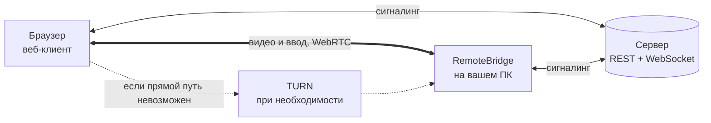
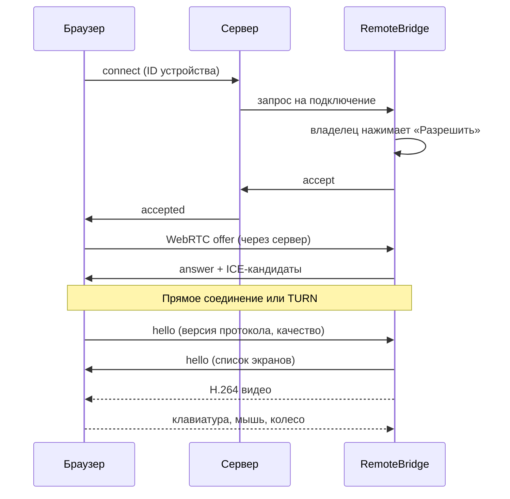
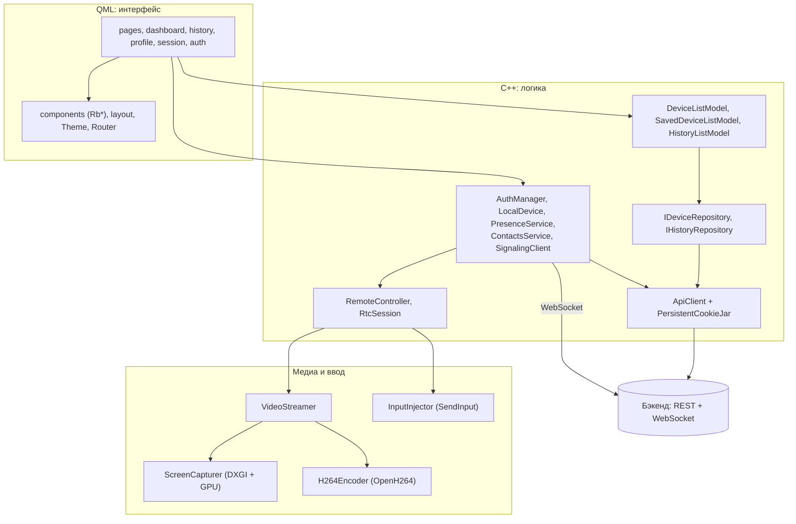
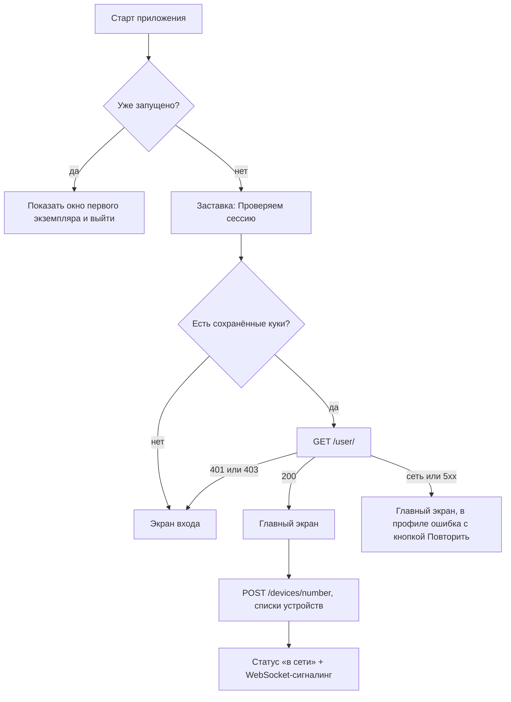
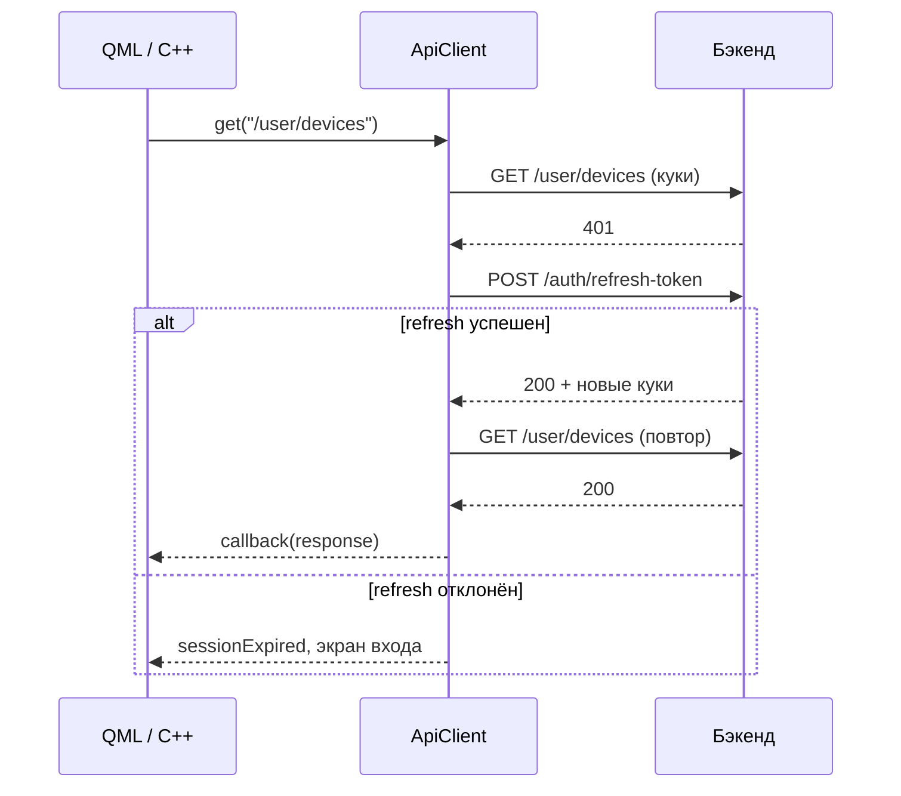

<div align="center">

# RemoteBridge

**Удалённый доступ к вашему компьютеру из браузера. Один ID, никаких паролей, VPN и настройки сети.**


[Сайт](https://remote.yarovich.ru) · [Скачать](https://github.com/RanVix/RemoteBridgePublic/releases/latest) · [Как это работает](#как-это-работает) · [Сборка из исходников](#сборка-из-исходников)

</div>

---

## О проекте

**RemoteBridge** — сервис удалённого доступа, который позволяет управлять компьютером с Windows из любого браузера.

Эта программа устанавливается на **принимающий компьютер** — тот, к которому нужно подключаться. Она получает собственный 12-значный ID, ждёт запросов и, когда владелец разрешает подключение, передаёт изображение экрана и принимает клавиатуру и мышь. Подключающемуся ничего устанавливать не нужно: достаточно открыть [веб-клиент](https://remote.yarovich.ru), ввести ID и дождаться подтверждения.

Видео и управление идут напрямую между браузером и программой по WebRTC, а при невозможности прямого соединения (разные сети, строгий NAT, файрвол) автоматически используется TURN-ретранслятор.

## Возможности

**Удалённое управление**
- Трансляция экрана в H.264 с задержкой, достаточной для комфортной работы
- Полноценный ввод: клавиатура (по физическим клавишам, раскладку определяет удалённая Windows), мышь, колесо, боковые кнопки
- Несколько мониторов: подключившийся выбирает, какой экран смотреть
- Три режима качества: «Скорость», «Баланс», «Качество»
- Форма курсора передаётся отдельно, поэтому он отзывчив и выглядит естественно
- Адаптивная частота кадров: при нагрузке на процессор программа сама снижает FPS, а затем возвращает его

**Контроль и безопасность**
- Каждое подключение подтверждает владелец, диалог нельзя закрыть случайным кликом
- Одновременно возможен только один сеанс, остальные запросы отклоняются автоматически
- Пока идёт сеанс, в окне приложения постоянно видна полоса «Идёт сеанс» с кнопкой «Отключить»
- При любом завершении сеанса все нажатые клавиши и кнопки мыши автоматически отпускаются
- Ввод принимается только после рукопожатия протокола, а частота событий ограничена
- Сессия входа хранится на диске в зашифрованном виде (Windows DPAPI)

**Удобство**
- Работает в трее: закрытие окна не прекращает приём подключений
- Один экземпляр приложения: повторный запуск просто показывает окно
- Уведомление о входящем запросе, даже если окно спрятано
- Онлайн-статус компьютера виден в списках устройств аккаунта
- Списки «Мои устройства» и «Сохранённые устройства», история подключений
- Автоматическое восстановление связи с сервером при обрыве

## Как это работает



Сервер используется только для входа, списков устройств и обмена служебными сообщениями (запрос, согласование соединения). Сами видео и ввод идут между браузером и приложением напрямую.

### Что происходит при подключении



## Установка

1. Скачайте `RemoteBridge-Setup-<версия>.exe` на странице [Releases](https://github.com/RanVix/RemoteBridgePublic/releases/latest).
2. Запустите установщик (потребуются права администратора, язык мастера — русский или английский).
3. Запустите RemoteBridge, войдите в аккаунт или зарегистрируйтесь.

**Требования:** Windows 10 или новее (64-бит), видеоадаптер с поддержкой Direct3D 11, доступ в интернет.

## Быстрый старт

1. **Войдите** в аккаунт на принимающем компьютере. На главном экране появится ваш 12-значный ID.
2. Нажмите **«Копировать ID»** и передайте его тому, кто будет подключаться (или откройте [веб-клиент](https://remote.yarovich.ru) сами с другого устройства).
3. В веб-клиенте введите ID. На принимающем компьютере появится окно **«Запрос на подключение»**.
4. Нажмите **«Разрешить»**: изображение экрана появится в браузере, управление включится.
5. Чтобы завершить сеанс, нажмите **«Отключить»** в полосе вверху окна или завершите его из браузера.

> Если вы вошли в один аккаунт на нескольких компьютерах, они все будут отображаться в списке «Мои устройства» с актуальным статусом «в сети».

### Окно и трей

Крестик окна **сворачивает приложение в трей**, подключения продолжают приниматься. Левый клик по значку открывает окно, в меню значка есть статус и пункт **«Выход»**. При выходе приложение сообщает серверу, что компьютер больше не в сети.

## Качество изображения

| Режим | Макс. FPS | Целевой битрейт | Потолок | Разрешение |
|---|---|---|---|---|
| Скорость | 30 | 1,5 Мбит/с | 2 Мбит/с | до 1280 px по ширине |
| Баланс | 30 | 3,5 Мбит/с | 4,5 Мбит/с | до 1280 px по ширине |
| Качество | 60 | 6 Мбит/с | 8 Мбит/с | нативное |

Режим меняется во время сеанса из панели в веб-клиенте. Кодек: H.264 Constrained Baseline (OpenH264), оптимизированный для содержимого экрана; цветовое пространство BT.709.

## Безопасность и приватность

- **Согласие владельца.** Ни одно подключение не устанавливается без нажатия «Разрешить» на принимающем компьютере. Рекомендуем разрешать подключение, только если вы знаете, кто его запросил.
- **Шифрование.** Видео и управление передаются по WebRTC (DTLS-SRTP); при работе через TURN-ретранслятор трафик остаётся зашифрованным.
- **Аутентификация.** Токены доступа хранятся в `httpOnly`-куках; приложение не читает и не логирует их значения. Файл сессии зашифрован через Windows DPAPI и может быть расшифрован только тем же пользователем Windows.
- **Логи.** Пароли, значения кук, содержимое SDP и события ввода в журнал не попадают.
- **Видимость.** О том, что идёт сеанс, приложение сообщает постоянной полосой в окне и подсказкой значка в трее.

## Ограничения

- Поддерживается только **Windows 10 и новее, x64**.
- Окна с повышенными правами, экран UAC и экран блокировки находятся на защищённом рабочем столе: изображение может пропасть, а ввод не выполняться, пока он не закрыт.
- Комбинация **Ctrl+Alt+Del** вызывается через `SendSAS` и без системной службы Windows обычно не срабатывает.
- Звук, буфер обмена и передача файлов пока не поддерживаются.

## Решение проблем

| Симптом | Что проверить |
|---|---|
| «Не удалось установить соединение с браузером» | Проверьте интернет на обеих сторонах. Между разными сетями нужен TURN: убедитесь, что сервер вернул его настройки (см. лог, категория `rb.rtc`) |
| Запрос не доходит до компьютера | В трее должен быть статус «В сети». Если там «Не в сети», проверьте доступ к серверу и войдите в аккаунт заново |
| Чёрный экран или пропало изображение | Возможно, открыт экран UAC или блокировки. Закройте его на принимающем компьютере |
| Не работает ввод в окне с правами администратора | Windows не разрешает обычному приложению вводить текст в окна с повышенными правами |
| «Версия приложения несовместима с сайтом» | Установите последнюю версию RemoteBridge |
| Второй запуск «ничего не делает» | Это нормально: приложение уже запущено, окно будет показано |

Подробности всегда можно найти в [журнале](#журнал-работы). При обращении в [Issues](https://github.com/RanVix/RemoteBridgePublic/issues) приложите нужный фрагмент, удалив из него личные данные.

---

# Для разработчиков

## Стек

| Слой | Технология |
|---|---|
| Язык | C++20 |
| Интерфейс | Qt 6.8+ (разработка ведётся на 6.11), Qt Quick / QML, стиль `Basic` с собственной дизайн-системой |
| Сеть | Qt Network (REST), Qt WebSockets (сигналинг) |
| Видеосвязь | [libdatachannel](https://github.com/paullouisageneau/libdatachannel) (WebRTC: ICE, DTLS-SRTP, RTP, data channels) |
| Кодирование | OpenH264 (CPU, режим экранного контента) |
| Захват экрана | DXGI Desktop Duplication + D3D11 Video Processor (цвет и масштаб на GPU) |
| Ввод | `SendInput` (скан-коды) |
| Хранение сессии | Windows DPAPI (`CryptProtectData`) |
| Иконки | Lucide (SVG), перекрашиваются через `QSvgRenderer` |
| Сборка | CMake 3.21+, Ninja, MSVC (Visual Studio 2022+), vcpkg |
| Установщик | Inno Setup 6 + `windeployqt` |
| Бэкенд и веб-клиент | Java (Spring: REST + WebSocket), Next.js; дизайн приложения повторяет сайт |

## Архитектура

Приложение разделено на два слоя: **QML** отвечает только за вид, **C++** за данные, сеть, состояние и медиа. QML ничего не знает о HTTP и WebRTC: он читает свойства синглтонов и моделей и вызывает их методы.



Ключевые идеи:

1. **Единая точка HTTP.** Весь REST-трафик идёт через `ApiClient`: он ведёт куки, логирует запросы и сам обновляет токен.
2. **Репозитории за интерфейсами.** Модели списков получают данные через `IDeviceRepository` / `IHistoryRepository`; источник можно заменить без правок QML.
3. **Синглтоны как мост в QML.** Классы регистрируются через `QML_ELEMENT` + `QML_SINGLETON` и доступны в QML по имени.
4. **Единая тема.** Все цвета, размеры и шрифты лежат в `Theme.qml`, в компонентах нет «магических» значений.
5. **Потоки разделены.** Захват и кодирование работают в потоке `VideoStreamer`, ввод инжектируется в своём потоке, сеть libdatachannel — в её собственных. Обратные вызовы библиотеки защищены `RtcLink`, поэтому уничтоженный сеанс не получает событий.
6. **Защита от устаревших ответов.** Классы, чьё состояние сбрасывается при выходе из аккаунта, используют счётчик поколений: запоздавший ответ предыдущего пользователя игнорируется.

### Поток запуска



## Структура репозитория

```
RemoteBridge/
├── CMakeLists.txt
├── CMakePresets.json             # общие пресеты (Ninja, MSVC x64)
├── CMakeUserPresets.json         # личный: путь к Qt и vcpkg (в .gitignore)
├── vcpkg.json                    # libdatachannel (srtp), openh264
│
├── src/
│   ├── app/main.cpp              # точка входа: лог, один экземпляр, QML-движок
│   ├── core/                     # сеть, авторизация, сигналинг, сервисы
│   │   ├── ApiClient.*           # HTTP-клиент: куки, refresh, логи
│   │   ├── PersistentCookieJar.* # куки на диск, шифрование DPAPI
│   │   ├── AuthManager.*         # вход, регистрация, выход, профиль
│   │   ├── LocalDevice.*         # 12-значный ID этого компьютера
│   │   ├── PresenceService.*     # статус «в сети» / «не в сети»
│   │   ├── ContactsService.*     # добавление устройства в контакты
│   │   ├── SignalingClient.*     # WebSocket-сигналинг, запросы и сеанс
│   │   ├── Endpoints.h           # адреса бэкенда и эндпоинтов
│   │   ├── Validation.*          # проверка форм
│   │   ├── LogMessages.h         # ВСЕ тексты логов в одном месте
│   │   └── Logging.*, FileLog.*  # категории и запись лога в файл
│   ├── remote/                   # удалённое управление
│   │   ├── RemoteController.*    # связывает сигналинг и WebRTC-сеанс
│   │   ├── RtcSession.*          # WebRTC: offer/answer, ICE, каналы, протокол
│   │   ├── ScreenCapturer.*      # DXGI Desktop Duplication + видеопроцессор
│   │   ├── H264Encoder.*         # OpenH264
│   │   ├── VideoStreamer.*       # поток «захват → кодирование → отправка»
│   │   ├── InputInjector.*       # SendInput в отдельном потоке
│   │   └── RemoteTypes.h         # экраны, профили качества, I420, RateLimiter
│   ├── platform/                 # трей, один экземпляр, иконка
│   ├── data/                     # репозитории устройств и истории (REST)
│   ├── models/                   # модели списков для QML
│   └── ui/IconImageProvider.*    # image://icons/<имя>/<цвет>
│
├── qml/
│   ├── Main.qml                  # окно, маршрутизация, жизненный цикл сессии
│   ├── theme/, navigation/       # Theme и Router (синглтоны)
│   ├── components/               # UI-кит Rb*
│   ├── layout/                   # AppShell, Sidebar, AuthLayout
│   ├── auth/, pages/, dashboard/, history/, profile/
│   └── session/                  # диалог входящего запроса, полоса сеанса
│
├── resources/                    # шрифты, иконки, app.rc.in, app.ico
└── installer/                    # build-installer.ps1, RemoteBridge.iss
```

> При добавлении `.qml`-файла впишите его в `QML_FILES` в `CMakeLists.txt`, нового C++-класса — в `SOURCES`.

### Экраны и маршруты

| Маршрут | Экран | Оболочка |
|---|---|---|
| `login`, `register`, `forgot-password` | формы авторизации | `AuthLayout` (сплит-экран) |
| `dashboard`, `history`, `profile` | страницы приложения | `AppShell` (сайдбар 240 px) |

Диалог входящего запроса и полоса активного сеанса отображаются поверх любого экрана.

## Ключевые механизмы

### Сигналинг

`SignalingClient` держит WebSocket `ws(s)://<хост>/api/v1/ws/app?number=<номер>`. Токен берётся из кук и подставляется в заголовок `Cookie` вручную, поскольку `QWebSocket` не использует cookie jar.

- Keep-alive ping каждые 25 с.
- Переподключение с экспоненциальной задержкой (1, 2, 4 … до 30 с). Перед повтором проверяется сессия через `GET /user/`, чтобы `ApiClient` при необходимости обновил токен.
- Счётчик попыток сбрасывается после 10 секунд стабильной работы.
- При потере связи ожидающий запрос и сеанс сбрасываются, как и на сервере.
- Одно устройство — один сеанс: параллельные запросы отклоняются автоматически.

| Приложение → сервер | Сервер → приложение |
|---|---|
| `accept`, `reject` (с `target`) | `connect_request` (`from`, `username`) |
| `disconnect` | `peer_disconnected` |
| `answer`, `ice`, `data` | `offer`, `ice`, `input`, `data` |
| | `error` (текст отображается пользователю по-русски) |

### WebRTC-сеанс

Offer создаёт браузер, приложение отвечает answer.

1. Приложение разбирает offer, находит видеосекцию с H.264 (`packetization-mode=1`, предпочтение Baseline/Constrained) и создаёт `send-only` видеотрек с тем же `mid`.
2. Перед созданием соединения запрашиваются ICE-серверы (`GET /webrtc/ice-servers`, данные временные и запрашиваются на каждый сеанс). Без ответа бэкенда используется публичный STUN. Сообщения браузера, пришедшие раньше, откладываются и применяются после создания соединения.
3. Видеотрек работает с пакетизатором H.264, RTCP Sender Reports, NACK-ответчиком и PLI-обработчиком (по PLI форсируется ключевой кадр).
4. Каналы данных: `control` (надёжный, упорядоченный) и `pointer` (неупорядоченный, без повторов; движения мыши нумеруются `seq`, устаревшие отбрасываются).
5. Трансляция стартует, когда открыт видеотрек **и** получен `hello` от браузера.
6. Таймауты: 30 с на установку соединения, 10 с на восстановление после обрыва.

### Протокол управления (версия 1)

Сообщения JSON поверх каналов `control` и `pointer`; поле `t` задаёт тип.

| Направление | Сообщение | Назначение |
|---|---|---|
| браузер → приложение | `hello {v, quality}` | рукопожатие, версия протокола и качество |
| | `key {down, code, key}` | клавиша (`code` — `KeyboardEvent.code`) |
| | `mouse-button {down, button, x, y}` | кнопка мыши |
| | `move {seq, x, y}` | движение (канал `pointer`) |
| | `wheel {dx, dy, x, y}` | колесо |
| | `release-all` | отпустить всё нажатое |
| | `special {action}` | `ctrl-alt-del` |
| | `quality {preset}` | `speed` / `balanced` / `quality` |
| | `screen {index}` | выбор монитора |
| приложение → браузер | `hello {v, screens, activeScreen, cursorInVideo}` | возможности |
| | `screen-changed {index}` | экран переключён |
| | `cursor {shape}` | форма курсора |

Координаты передаются нормализованными в диапазоне `0…65535` относительно выбранного экрана. Несовпадение версии протокола завершает сеанс с понятным сообщением. Лимиты: до 250 событий движения и до 1000 прочих событий в секунду.

### Захват и кодирование

`ScreenCapturer` получает изображение через Desktop Duplication, копирует его в BGRA-текстуру, а D3D11 Video Processor на GPU конвертирует цвет в NV12 с масштабированием. На CPU читается уже готовый кадр и раскладывается в I420 для OpenH264.

Кодировщик настроен на `SCREEN_CONTENT_REAL_TIME`, без B-кадров, с бесконечным GOP (ключевые кадры только по запросу), CAVLC и несколькими слайсами для многопоточного кодирования. Неподвижный экран продолжает отправлять кадр не реже раза в секунду. При потере доступа к экрану (смена режима, UAC) поток автоматически пытается восстановить захват.

### HTTP-клиент и обновление токена

`ApiClient` повторяет логику веб-клиента: единый клиент с куками, на 401 один раз обновляет токен и повторяет запрос. Параллельные запросы с 401 ждут один общий refresh.



- Эндпоинты `login`, `register`, `refresh-token`, `logout` refresh не запускают.
- Если refresh не удался из-за сети или 5xx, пользователь не выбрасывается на экран входа.
- Опция `skipAuthHandling` отключает refresh для «тихих» проверок.
- Таймаут запроса — 15 секунд; callback привязан к объекту-контексту и не вызывается, если тот уничтожен.

### Куки и сессия

- `PersistentCookieJar` сохраняет куки в `%LOCALAPPDATA%\RemoteBridge\RemoteBridge\session.dat`, шифруя их через DPAPI. Сессионные куки тоже сохраняются, чтобы вход переживал перезапуск.
- Для `localhost`, `127.0.0.1` и `::1` jar отдаёт `Secure`-куки и по `http`, как это делают браузеры. Для любого другого хоста нужен `https`.

## REST API

Адрес по умолчанию: `https://remote.yarovich.ru/api/v1` (переопределяется переменной `RB_API_URL`).

| Метод | Путь | Назначение |
|---|---|---|
| POST | `/auth/register` | регистрация (`username`, `email`, `password`); 409 — пользователь существует |
| POST | `/auth/login` | вход, токены приходят в `Set-Cookie`; 401 — неверные данные |
| POST | `/auth/refresh-token` | обновление токенов (refresh берётся из куки) |
| POST | `/auth/logout` | выход |
| GET | `/user/` | профиль: `id`, `username`, `email` |
| POST | `/devices/number` | `{os_type, model}` → 12-значный номер; регистрирует устройство при необходимости |
| GET | `/user/devices` | личные устройства |
| PUT | `/user/devices/{id}` | `{name, is_online}`: онлайн-статус устройства |
| GET | `/user/saved-devices` | сохранённые чужие устройства |
| PUT | `/user/saved-devices` | `{number}`: сохранить устройство; 404, 409, 429 |
| GET | `/user/devices/{number}/history` | история подключений к устройству |
| GET | `/webrtc/ice-servers` | временные STUN/TURN на сеанс |

Поля устройства: `id`, `number`, `name`, `os_type`, `model`, `is_online`, `last_online`, `created_at`.

> Бэкенд на запрос без куки отвечает **403**, а не 401, поэтому refresh на 403 не запускается.

## Сборка из исходников

### Требования

- Windows 10+, 64-бит
- Visual Studio 2022 или новее с набором «Разработка классических приложений на C++» (MSVC, Windows SDK)
- Qt 6.8+ для `MSVC 64-bit` (модули Quick, QuickControls2, Network, Svg, Widgets, WebSockets)
- CMake 3.21+ и Ninja (идут с Visual Studio и Qt)
- [vcpkg](https://github.com/microsoft/vcpkg): зависимости `libdatachannel[srtp]` и `openh264` описаны в `vcpkg.json`
- Шрифты Manrope (`.ttf`) и Inter (`.otf` / `.ttf`) в `resources/fonts/`: статические начертания, не variable
- Необязательно: `resources/app.ico` для значка исполняемого файла и установщика

### Шаги

1. Склонируйте репозиторий и положите шрифты в `resources/fonts/`.
2. Создайте в корне **`CMakeUserPresets.json`** с путями к Qt и vcpkg:

   ```json
   {
     "version": 3,
     "configurePresets": [
       {
         "name": "local",
         "hidden": true,
         "cacheVariables": {
           "CMAKE_PREFIX_PATH": "C:/Qt/6.8.0/msvc2022_64",
           "CMAKE_TOOLCHAIN_FILE": "C:/vcpkg/scripts/buildsystems/vcpkg.cmake",
           "VCPKG_TARGET_TRIPLET": "x64-windows"
         }
       },
       {
         "name": "debug",
         "displayName": "Debug",
         "inherits": ["local", "msvc-debug"]
       },
       {
         "name": "release",
         "displayName": "Release",
         "inherits": ["local", "msvc-release"]
       }
     ]
   }
   ```

3. Откройте папку в Visual Studio (**File → Open → Folder**), выберите конфигурацию **Debug** и соберите проект. Либо откройте `CMakeLists.txt` в Qt Creator с комплектом `Desktop Qt … MSVC 64-bit`. Либо из консоли разработчика:

   ```powershell
   cmake --preset release
   cmake --build out/build/release --parallel
   ```

4. Если менялись списки файлов в `CMakeLists.txt`, выполните **Delete Cache and Reconfigure**. После правки C++-классов, регистрируемых в QML, нужна полная пересборка.

Debug-сборка запускается с консолью, Release — как GUI-приложение без консоли.

### Сборка установщика

Нужны собранная Release-конфигурация (`out/build/release`), Qt с `windeployqt` и [Inno Setup 6](https://jrsoftware.org/isinfo.php):

```powershell
.\installer\build-installer.ps1
```

Скрипт собирает проект, раскладывает приложение в `dist/RemoteBridge`, подтягивает Qt-зависимости через `windeployqt`, копирует DLL из vcpkg и компилирует установщик. Результат: `dist/RemoteBridge-Setup-<версия>.exe`. Версия берётся из `project(RemoteBridge VERSION …)` в `CMakeLists.txt`. Установщик завершает запущенное приложение перед обновлением и удалением, так как оно живёт в трее.

## Настройка

| Переменная | Назначение |
|---|---|
| `RB_API_URL` | адрес REST API без завершающего слэша |
| `RB_WS_URL` | адрес WebSocket без `/app` и параметров (по умолчанию выводится из `RB_API_URL`: `http→ws`, `https→wss`) |
| `RB_ICE_SERVERS` | список STUN/TURN через запятую вместо данных бэкенда, например `stun:host:3478,turn:user:pass@host:3478` |
| `RB_ICE_POLICY` | `relay` — использовать только TURN (для проверки ретранслятора) |
| `QT_LOGGING_RULES` | фильтрация логов, например `rb.api.debug=false` |

```powershell
$env:RB_API_URL = "http://localhost:8888/api/v1"
```

## Журнал работы

Лог выводится в консоль и дублируется в файл:

```
%LOCALAPPDATA%\RemoteBridge\RemoteBridge\logs\remotebridge.log
```

Файл ротируется при достижении 2 МБ (старый сохраняется как `remotebridge.log.old`). В Release-сборке `debug`-сообщения отключены.

| Категория | Что пишет |
|---|---|
| `rb.app` | запуск, шрифты, трей, один экземпляр |
| `rb.auth` | вход, регистрация, выход, профиль, восстановление сессии |
| `rb.api` | запросы и ответы (метод, путь, статус, время), refresh, атрибуты кук |
| `rb.device` | ID компьютера, списки устройств, контакты, история, онлайн-статус |
| `rb.signaling` | WebSocket: подключение, запросы, сеанс |
| `rb.rtc` | WebRTC, выбранный сетевой путь (`host` / `srflx` / `relay`), захват, кодек, статистика потока |

Все тексты сообщений находятся в одном файле `src/core/LogMessages.h`: чтобы изменить формулировку, вызывающий код трогать не нужно.

```
10:46:11.546 info [rb.api] #2 --> POST /auth/login
10:46:11.617 info [rb.api] #2 <-- POST /auth/login : 200 (70 мс)
10:46:19.204 info [rb.rtc] WebRTC: выбранный путь: local=host, remote=host
```

## Дизайн-система

Единственный источник значений — `qml/theme/Theme.qml`.

- **Акцент:** мятно-зелёный (`mint500 #1FAE7C`), используется точечно: кнопки, статусы, активные пункты меню.
- **Тёмный графит** с зелёным подтоном (`ink900 #10221C`) для сайдбара и тёмных блоков.
- **Красный** только для ошибок и отказов.
- **Шрифты:** Manrope (заголовки, крупные числа) и Inter (интерфейс).
- **Карточки:** `RbCard`, скругление 16 px, тонкая рамка, без теней.

UI-кит (`qml/components`): `RbButton`, `RbInput`, `RbCard`, `RbCardTitle`, `RbStatCard`, `RbAvatar`, `RbStatusDot`, `RbToast`, `RbEmptyState`, `RbLink`, `RbBackLink`, `RbIcon`, `RbLogo`, `RbToolTip`.

## Соглашения по коду

- C++20, предупреждения MSVC `/W4`, исходники в UTF-8.
- Включения от папки `src`: `#include "core/ApiClient.h"`.
- QML-типы регистрируются макросами `QML_ELEMENT` / `QML_SINGLETON` в самих классах.
- Префикс `Rb` у компонентов UI-кита; в компонентах нет жёстко прописанных цветов и размеров, только `Theme.*`.
- Тексты интерфейса оборачиваются в `qsTr()`.
- Состояния загрузки и ошибки показываются всегда: скелетон, баннер ошибки, кнопка «Повторить».
- Пароли, значения кук, содержимое SDP и события ввода в логи не пишутся.
- Заголовки libdatachannel подключаются **до** Qt (макросы `signals` / `slots` / `emit` конфликтуют).

Предложения и найденные ошибки приветствуются в [Issues](https://github.com/RanVix/RemoteBridgePublic/issues).

---

<div align="center">

© 2026 RanVix, Yarovich

</div>