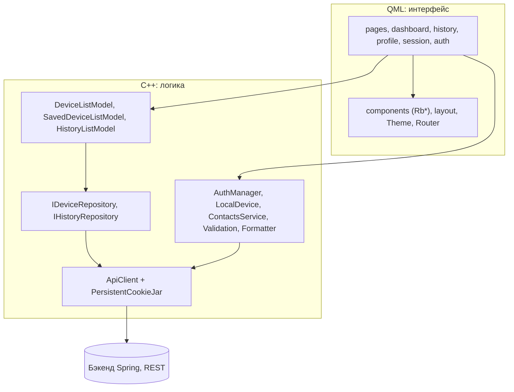
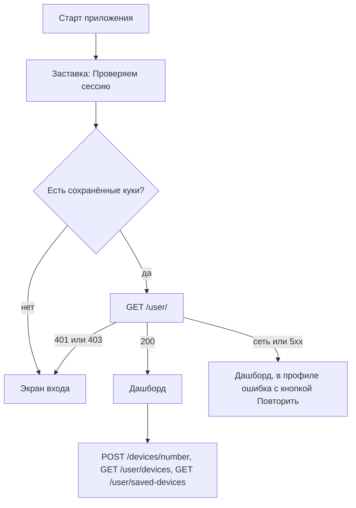
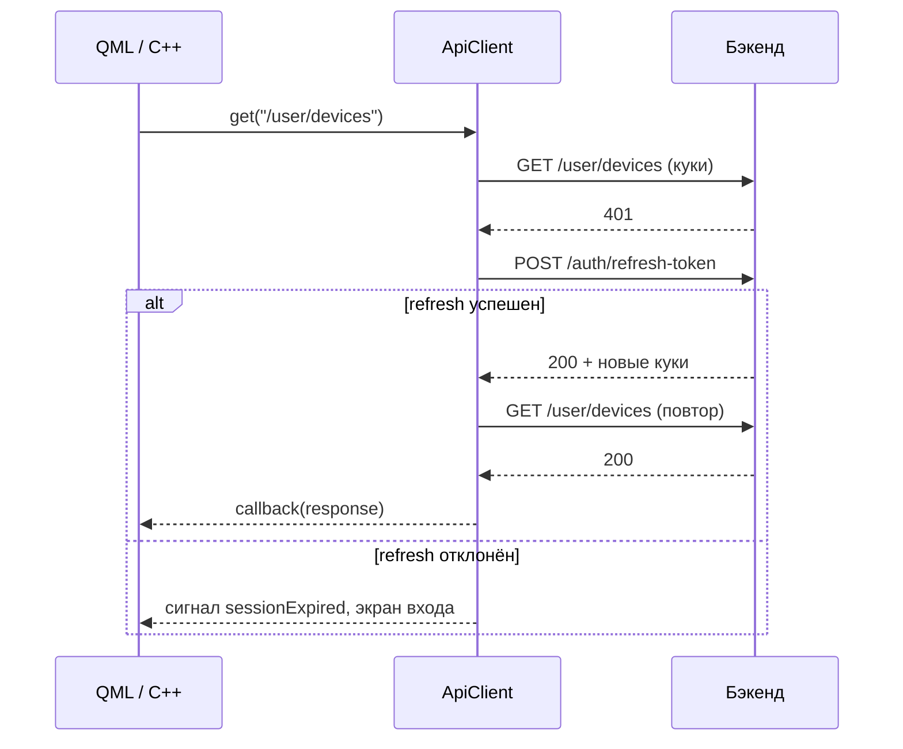

# RemoteBridge Desktop

Десктопное приложение сервиса удалённого доступа **RemoteBridge** (в духе AnyDesk, со своим брендом).
Один клиент умеет и **принимать** подключения (у компьютера есть 12-значный ID), и **подключаться** к другим компьютерам по ID.

> Только Windows

## Содержание

- [Состояние проекта](#состояние-проекта)
- [Стек](#стек)
- [Как это устроено](#как-это-устроено)
- [Структура репозитория](#структура-репозитория)
- [Ключевые механизмы](#ключевые-механизмы)
- [REST API](#rest-api)
- [Дизайн-система](#дизайн-система)
- [Сборка и запуск](#сборка-и-запуск)
- [Логи](#логи)
- [Соглашения по коду](#соглашения-по-коду)
- [Дорожная карта](#дорожная-карта)

## Состояние проекта

| Функция | Статус | Источник данных |
|---|---|---|
| Регистрация, вход, выход | Готово | REST |
| Сохранение сессии между запусками | Готово | куки, зашифрованные DPAPI |
| Автообновление токена (refresh) | Готово | REST |
| Профиль пользователя | Готово | `GET /user/` |
| ID этого компьютера (12 цифр) | Готово | `POST /devices/number` |
| Мои устройства | Готово | `GET /user/devices` |
| Сохранённые устройства (контакты) | Готово | `GET /user/saved-devices` |
| Добавление в контакты из истории | Готово | `PUT /user/saved-devices` |
| История подключений | Макет на моках | нет эндпоинта на бэке |
| Восстановление пароля | Макет, письмо не отправляется | нет эндпоинта на бэке |
| Удаление из контактов | Не начато | нужен эндпоинт |
| Окно удалённой сессии | Заглушка (лоадер) | ждёт сигналинг и WebRTC |
| Трей, автозапуск, один экземпляр | Не начато | этап 5 |
| WebSocket-сигналинг, WebRTC, захват экрана | Не начато | этапы 6-7 |

Всё, что ещё не подключено к бэкенду, в интерфейсе отображается честно: кнопка видна, но неактивна, а при наведении объясняет почему.

## Стек

| Слой | Технология |
|---|---|
| Язык | C++20 |
| UI | Qt 6.8+ (разработка идёт на 6.11), Qt Quick / QML, стиль `Basic` с собственной дизайн-системой |
| Сеть | Qt Network (`QNetworkAccessManager`) |
| Иконки | Lucide (SVG, ISC), перекрашиваются в C++ через `QSvgRenderer` |
| Сборка | CMake 3.21+, Ninja, MSVC (Visual Studio 2022 или новее) |
| Шифрование сессии | Windows DPAPI (`CryptProtectData`) |
| Бэкенд | Java, Spring: REST + WebSocket для сигналинга WebRTC |
| Веб-клиент | Next.js, TypeScript, Tailwind CSS v4 (дизайн приложения повторяет сайт) |

Схема связи всей системы: приложение и сайт ходят на бэкенд по REST, сигналинг идёт через WebSocket,
а видео и ввод между клиентом и агентом должны передаваться напрямую по WebRTC, минуя сервер.

## Как это устроено

Приложение разделено на два слоя: **QML** отвечает только за вид, **C++** за данные, сеть и состояние.
QML не знает ничего о HTTP: он читает свойства синглтонов и моделей и вызывает их методы.



Главные идеи:

1. **Единая точка HTTP.** Весь сетевой трафик идёт через `ApiClient`. Он ведёт куки, логирует запросы и сам обновляет токен.
2. **Репозитории за интерфейсами.** Модели списков получают данные через `IDeviceRepository` / `IHistoryRepository`.
   Сейчас устройства приходят по REST, история из мока. Замена источника не требует правок QML.
3. **Синглтоны как мост в QML.** `AuthManager`, `LocalDevice`, `ContactsService` и др. регистрируются через `QML_ELEMENT` + `QML_SINGLETON` и доступны в QML по имени.
4. **Единая тема.** Все цвета, размеры и шрифты лежат в `Theme.qml`, в компонентах нет «магических» значений.

### Поток запуска



`Main.qml` управляет всей жизнью сессии: при входе он запрашивает ID компьютера и оба списка устройств,
при выходе сбрасывает всё состояние (`LocalDevice`, оба списка, `ContactsService`), чтобы следующий пользователь не увидел чужие данные.

## Структура репозитория

```
RemoteDesktopApp/
├── CMakeLists.txt
├── CMakePresets.json              # общие пресеты сборки (Ninja, MSVC x64)
├── CMakeUserPresets.json          # личный: путь к Qt (в .gitignore)
│
├── src/
│   ├── app/
│   │   └── main.cpp               # точка входа: шрифты, лог, QML-движок
│   ├── core/                      # сеть, авторизация, сервисы, утилиты
│   │   ├── ApiClient.*            # HTTP-клиент: куки, refresh, логи
│   │   ├── ApiError.*             # разбор ошибок бэкенда в понятный текст
│   │   ├── Endpoints.h            # адрес бэкенда и пути эндпоинтов
│   │   ├── PersistentCookieJar.*  # куки на диск, шифрование DPAPI
│   │   ├── AuthManager.*          # вход, регистрация, выход, профиль
│   │   ├── LocalDevice.*          # 12-значный ID этого компьютера
│   │   ├── ContactsService.*      # добавление чужого устройства в контакты
│   │   ├── Validation.*           # проверка форм (как lib/validation на сайте)
│   │   ├── TextUtils.h            # инициалы, форматирование ID
│   │   ├── Formatter.h            # TextUtils для QML
│   │   ├── Logging.*              # категории логов
│   │   ├── LogMessages.h          # ВСЕ тексты логов в одном месте
│   │   └── FileLog.*              # дублирование лога в файл
│   ├── data/                      # источники данных
│   │   ├── IDeviceRepository.h
│   │   ├── IHistoryRepository.h
│   │   ├── RestDeviceRepository.* # устройства по REST (путь задаётся параметром)
│   │   └── MockHistoryRepository.*# история: мок
│   ├── models/                    # модели данных и списки для QML
│   │   ├── Device.h, SessionRecord.h
│   │   ├── DeviceListModel.*      # мои устройства
│   │   ├── SavedDeviceListModel.* # сохранённые (наследник DeviceListModel)
│   │   └── HistoryListModel.*
│   └── ui/
│       └── IconImageProvider.*    # image://icons/<имя>/<цвет>
│
├── qml/
│   ├── Main.qml                   # окно, выбор экрана, жизненный цикл сессии
│   ├── theme/Theme.qml            # дизайн-токены (синглтон)
│   ├── navigation/Router.qml      # текущий маршрут (синглтон)
│   ├── components/                # UI-кит: Rb* (кнопки, поля, карточки, тосты...)
│   ├── layout/                    # AppShell, Sidebar, AuthLayout
│   ├── auth/                      # формы входа, регистрации, восстановления пароля
│   ├── pages/                     # DashboardPage, HistoryPage, ProfilePage
│   ├── dashboard/                 # MyIdCard, ConnectPanel, DeviceList, DeviceRow
│   ├── history/                   # HistoryList, HistoryRow
│   ├── profile/                   # ProfileHeader, ProfileSkeleton, ProfileError, ...
│   └── session/                   # окно удалённой сессии (заглушка)
│
└── resources/
    ├── fonts/                     # Manrope, Inter (статические .ttf/.otf)
    └── icons/                     # Lucide SVG
```

QML-файлы и ресурсы подхватываются через `qt_add_qml_module`, шрифты и иконки через `file(GLOB ...)` с `CONFIGURE_DEPENDS`.
При добавлении нового `.qml` его нужно **вписать в список `QML_FILES`** в `CMakeLists.txt`, новый C++-класс в `SOURCES`.

### Экраны и маршруты

`Router.route` определяет, какой экран показывает `Main.qml`:

| Маршрут | Экран | Оболочка |
|---|---|---|
| `login`, `register`, `forgot-password` | формы авторизации | `AuthLayout` (сплит-экран) |
| `dashboard`, `history`, `profile` | страницы приложения | `AppShell` (сайдбар 240 px) |
| `session` | удалённая сессия | полноэкранно, без сайдбара |

## Ключевые механизмы

### 1. HTTP-клиент и обновление токена

`ApiClient` повторяет логику `client.ts` веб-версии: единый клиент с куками, на 401 один раз обновляет токен и повторяет запрос.
Параллельные запросы, получившие 401, ждут один общий refresh.



Нюансы:

- Эндпоинты `login`, `register`, `refresh-token` и `logout` refresh не запускают (чтобы не зациклиться).
- Если refresh не удался из-за **сети или ответа 5xx**, это не считается «сессия истекла», пользователя не выкидывает на вход.
- Опция `skipAuthHandling` отключает refresh для «тихих» проверок (аналог одноимённого флага на сайте).
- Таймаут запроса: 15 секунд. Адрес бэкенда: `Endpoints::baseUrl()`.
- Callback привязан к объекту-контексту: если он уничтожен до прихода ответа, callback не вызывается.

### 2. Куки и сессия

Токены (`access_token`, `refresh_token`) приходят в `httpOnly`-куках, приложение их значений не читает и не логирует.

- `PersistentCookieJar` сохраняет куки в `%LOCALAPPDATA%\RemoteBridge\RemoteBridge\session.dat`.
  Файл шифруется **Windows DPAPI**: расшифровать его может только тот же пользователь Windows.
- Сессионные куки (без срока жизни) тоже сохраняются, иначе вход не переживал бы перезапуск.
- **`Secure`-куки на `localhost`.** Бэкенд ставит флаг `Secure`, а на dev-окружении используется `http://localhost`.
  Браузеры в этом случае всё равно отправляют куки, Qt по умолчанию нет. Поэтому для `localhost`, `127.0.0.1` и `::1` jar подставляет защищённую схему при выборе кук.
  Для любого другого хоста Qt ведёт себя штатно, на проде нужен https.

### 3. Защита от устаревших ответов

Классы, которые делают запросы и могут быть сброшены во время ожидания (`LocalDevice`, `ContactsService`, `RestDeviceRepository`),
используют счётчик поколений: перед запросом он увеличивается, и если к моменту ответа значение другое
(пользователь вышел), ответ игнорируется. Благодаря этому запоздавший ответ предыдущего пользователя не попадёт на экран следующего.

### 4. Модели списков

`DeviceListModel` (QAbstractListModel) умеет:

- `reload()` загрузить, если сейчас не грузится; `refresh()` загрузить, а если уже идёт загрузка, повторить сразу после неё;
- `clear()` очистить и отменить запрос в пути;
- `setExcludedNumber()` скрывать из списка этот компьютер;
- `containsNumber()` + `revision` проверять наличие номера из QML с автоматическим пересчётом.

`SavedDeviceListModel` наследуется от неё и меняет только источник (`/user/saved-devices`).
Компонент `DeviceList.qml` универсален: заголовок, модель и тексты пустого состояния передаются свойствами.

### 5. Иконки

QML запрашивает `image://icons/<имя>/<hex-цвет>`. `IconImageProvider` рендерит SVG из ресурсов и перекрашивает его в нужный цвет.
Компонент `RbIcon` скрывает эти детали: `RbIcon { name: "copy"; color: Theme.mint600 }`.

## REST API

Адрес по умолчанию: `http://localhost:8888/api/v1`, переопределяется переменной окружения `RB_API_URL`.

| Метод | Путь | Назначение | Где используется |
|---|---|---|---|
| POST | `/auth/register` | регистрация (`username`, `email`, `password`); 409: пользователь существует | `AuthManager` |
| POST | `/auth/login` | вход (`email`, `password`), токены в `Set-Cookie`; 401: неверные данные | `AuthManager` |
| POST | `/auth/refresh-token` | обновить токены (refresh берётся из куки) | `ApiClient` |
| POST | `/auth/logout` | выход, бэкенд обнуляет токены | `AuthManager` |
| GET | `/user/` | профиль: `id`, `username`, `email` | `AuthManager` |
| POST | `/devices/number` | `{os_type, model}`, возвращает 12-значный номер, регистрирует устройство, если его нет | `LocalDevice` |
| GET | `/user/devices` | личные устройства пользователя | `DeviceListModel` |
| GET | `/user/saved-devices` | сохранённые чужие устройства | `SavedDeviceListModel` |
| PUT | `/user/saved-devices` | `{number}`, сохранить чужое устройство; 404, 409, 429 | `ContactsService` |

Поля устройства в ответах: `id`, `number`, `name`, `os_type`, `model`, `is_online`, `last_online`, `created_at`.

### Известные ограничения

- Бэкенд на запрос без куки отвечает **403**, а не 401, поэтому refresh на 403 не запускается. Если access-токен истечёт во время работы и бэкенд ответит 403,
  придётся войти заново. Это место для будущей доработки.
- Тела запросов (пароли) и значения кук в логи не попадают. Тела **ответов с ошибкой** (статус 400 и выше) пишутся в лог, чтобы видеть формат.

## Дизайн-система

Приложение повторяет дизайн веб-версии. Единственный источник значений — `qml/theme/Theme.qml`.

- **Основной акцент:** мятно-зелёный (`mint500 #1FAE7C`, оттенки `mint50 … mint700`), используется точечно: кнопки, статусы, активные пункты меню, иконки-чипы.
- **Тёмный графит** с зелёным подтоном (`ink900 #10221C`) для сайдбара и тёмных блоков, не чистый чёрный.
- **Красный** (`red500`) только для настоящих ошибок и неудач.
- **Шрифты:** Manrope (заголовки, бренд, крупные числа) и Inter (интерфейс и текст).
- **Карточки:** `RbCard`, скругление 16 px, hairline-рамка `line`, без теней.
- **Правило для недоступных функций:** кнопка видна, но неактивна, с подсказкой при наведении. Мы не изображаем, что функция работает.

UI-кит (`qml/components`):

| Компонент | Назначение |
|---|---|
| `RbButton` | кнопка: `primary`, `secondary`, `ghost`, `danger`; размеры `sm`, `md`, `lg`; иконки; подсказка у неактивной |
| `RbInput` | поле ввода: подпись, иконка, ошибка, подсказка |
| `RbCard`, `RbCardTitle` | карточка и её серый заголовок |
| `RbStatCard` | карточка со статистикой |
| `RbAvatar`, `RbStatusDot` | аватар с инициалами, индикатор статуса устройства |
| `RbToast` | всплывающее уведомление (успех, ошибка) |
| `RbEmptyState` | пустое состояние списка |
| `RbLink`, `RbBackLink` | текстовые ссылки |
| `RbIcon`, `RbLogo`, `RbToolTip` | иконка, логотип, подсказка |

## Сборка и запуск

### Требования

- Windows 10 и новее, 64-бит
- Visual Studio 2022 или новее с набором «Разработка классических приложений на C++» (MSVC, Windows SDK)
- Qt 6.8 или новее для `MSVC 64-bit` (модули Quick, QuickControls2, Network, Svg входят в основной пакет)
- CMake 3.21+ и Ninja (идут в составе Visual Studio и Qt)
- Запущенный бэкенд (по умолчанию на `localhost:8888`)

### Шаги

1. Склонируй репозиторий и положи шрифты в `resources/fonts/` (Manrope: `.ttf`, Inter: `.otf`/`.ttf`, статические начертания, не variable).
2. Создай в корне **`CMakeUserPresets.json`** с путём к своей установке Qt:

   ```json
   {
     "version": 3,
     "configurePresets": [
       {
         "name": "qt-local",
         "hidden": true,
         "cacheVariables": { "CMAKE_PREFIX_PATH": "C:/Qt/6.8.0/msvc2022_64" }
       },
       {
         "name": "debug",
         "displayName": "Debug (Qt)",
         "inherits": ["qt-local", "msvc-debug"]
       },
       {
         "name": "release",
         "displayName": "Release (Qt)",
         "inherits": ["qt-local", "msvc-release"]
       }
     ]
   }
   ```

3. Открой папку в Visual Studio (**File → Open → Folder**), выбери конфигурацию **Debug (Qt)** и собери проект.
   Либо открой `CMakeLists.txt` в Qt Creator с комплектом `Desktop Qt ... MSVC 64-bit`.
4. Если файлы добавлялись или менялись списки в `CMakeLists.txt`, сделай **Delete Cache and Reconfigure**.
   После правки C++-классов, регистрируемых в QML, нужна полная пересборка (**Rebuild All**).

Рекомендуемый `.gitignore`:

```
out/
build/
.vs/
CMakeUserPresets.json
```

### Настройка адреса бэкенда

```powershell
$env:RB_API_URL = "https://api.example.com/api/v1"   # без завершающего слэша
```

## Логи

Лог пишется в консоль (кириллица выводится корректно через собственный обработчик) и в файл:

```
%LOCALAPPDATA%\RemoteBridge\RemoteBridge\logs\remotebridge.log
```

При размере больше 2 МБ файл ротируется в `remotebridge.log.old`.

Категории:

| Категория | Что пишет |
|---|---|
| `rb.app` | запуск, шрифты |
| `rb.auth` | вход, регистрация, выход, профиль, восстановление сессии |
| `rb.api` | каждый запрос и ответ (метод, путь, статус, время), refresh, атрибуты кук |
| `rb.device` | ID компьютера, списки устройств, контакты |

Уровни настраиваются переменной окружения, например:

```powershell
$env:QT_LOGGING_RULES = "rb.api.debug=false"
```

**Все тексты сообщений лога находятся в одном файле `src/core/LogMessages.h`**: чтобы поменять формулировку, код вызывающих мест трогать не нужно.

Пример строк лога:

```
10:46:11.546 info [rb.api] #2 --> POST /auth/login
10:46:11.617 info [rb.api] #2 <-- POST /auth/login : 200 (70 мс)
10:46:11.617 info [rb.api] Set-Cookie: access_token (domain=, path=/, secure=да, httpOnly=да, до ...)
```

## Соглашения по коду

- **C++20**, предупреждения MSVC `/W4`, исходники в UTF-8.
- Включения вида `#include "core/ApiClient.h"` (от папки `src`).
- QML-типы регистрируются макросами `QML_ELEMENT` / `QML_SINGLETON` в самих классах, ручной `qmlRegisterType` не используется.
- Префикс `Rb` у всех компонентов UI-кита. В компонентах нет жёстко прописанных цветов и размеров, только `Theme.*`.
- Тексты интерфейса оборачиваются в `qsTr()`.
- Состояния загрузки и ошибки показываются всегда: скелетон, баннер ошибки, кнопка «Повторить».
- Пароли и значения кук в логи не пишутся.
- Код в QML-файлах: приватные вычисляемые свойства начинаются с `_` или помечаются `readonly`.

## Дорожная карта

1. **Этап 5.** Системная интеграция: иконка в трее, один экземпляр приложения, установщик.
2. **Этап 6.** WebSocket-клиент для сигналинга (понадобится спецификация протокола бэкенда: URL, формат сообщений, авторизация).
3. **Этап 7.** Удалённый доступ: захват экрана (DXGI), кодирование видео и ввод (`SendInput`) на принимающей стороне; приём, декодирование и отрисовка видео, отправка ввода на управляющей. WebRTC через libdatachannel.
4. **По мере появления эндпоинтов:** история подключений, восстановление пароля, удаление из контактов, редактирование профиля.
5. Состояние «Занято» у устройства и статус «В сети» самого компьютера появятся вместе с сигналингом.
